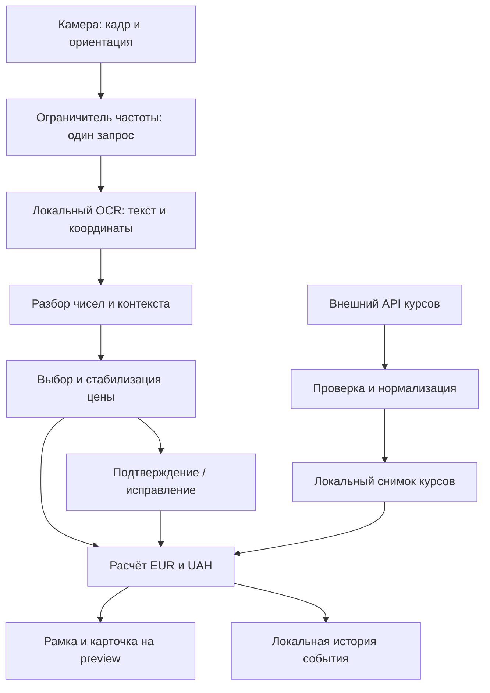

# 4. Технический проект

**Решение от 04.11.2026.** Основная архитектура заменена на SPA/PWA с GitHub Pages. Текущий проект описан в [документе 9](09-web-app.md). Ниже сохранён первоначальный нативный проект для понимания предыдущего прототипа. Разработка Android/iOS приостановлена.

Версия 0.1 · статус обновлён 03.11.2026. **Целевая архитектура MVP**; в текущем прототипе реализована её часть. На момент первоначальной подготовки документа в проекте был только файл со ссылкой на ТЗ. Теперь Android-сборка и локальный OCR проверены; конкретные версии и ограничения — в [состоянии прототипа](08-prototype-status.md).

## 4.1. Предлагаемый стек и ограничения

| Часть | Предложение | Причина / ограничение |
|---|---|---|
| Приложение | Flutter / Dart | Общая кодовая база для iOS и Android, как предложено в исходном обсуждении |
| Камера | Пакет `camera` от flutter.dev | Preview, поток кадров и управление камерой; проверить связку с OCR на обеих платформах |
| OCR | Native ML Kit Text Recognition, латинская модель, через Flutter-мост | Числа и RON/LEI, локальная обработка; мост и нативный SDK — разные зависимости |
| Локальные данные | SQLite, один файл БД | История, снимки курсов, настройки; выбрать одну поддерживаемую Flutter-библиотеку после проверки совместимости |
| HTTP | Один клиент и адаптер выбранного API курсов | Один поставщик в MVP, без автоматического переключения множества источников |
| Деньги | Целые баны + десятичные коэффициенты и расчёты | Избежать ошибок округления; точные правила — документ 3 |
| Backend | Собственный сервис не планируется | Нужны только локальные функции и внешний источник курсов |

ML Kit предоставляет текст и геометрию блоков; это основа для выделения цены, но не готовый классификатор ценников. Поддержка латиницы и структуры текста описана в [документации Google](https://developers.google.com/ml-kit/vision/text-recognition/v2).

Вариант Flutter-моста `google_mlkit_text_recognition` поддерживает iOS/Android и прямо сообщает, что его не сопровождает Google. На дату проверки его README указывает минимум iOS 15.5. Это предварительная граница для проверки, а не утверждённая поддержка продукта. [Документация самого пакета](https://pub.dev/packages/google_mlkit_text_recognition).

Пакет `camera` на дату проверки указывает Android SDK 24+ и iOS 13.0+. Поэтому для начальной проверки связки предлагается **Android API 24+ и iOS 15.5+**, если зафиксированные версии остальных зависимостей не требуют более новых ОС. Итоговые deployment targets определяются сборкой и реальными тестами, учитывая требования всех нативных библиотек. `targetSdk` и `compileSdk` — отдельные параметры, их не брать из старого примера. [README camera](https://pub.dev/packages/camera).

Для Android выбрать **встроенную OCR-модель**, чтобы после установки распознавание не требовало первой загрузки модели. Google различает bundled/unbundled варианты и указывает, что динамический вариант может ожидать загрузки. Проверить, какой вариант реально включён мостом. [ML Kit Android: установка](https://developers.google.com/ml-kit/vision/text-recognition/v2/android).

Если Flutter-мост не удовлетворяет качеству, координатам или стабильности, сначала локализовать проблему; возможная альтернатива для iOS — Apple Vision, уже упомянутая в ТЗ. Не реализовывать два OCR-движка заранее. Выбор отдельного движка оформлять решением с повторной приёмкой.

## 4.2. Поток данных



Кадры и полный OCR-текст существуют в оперативной памяти только на время обработки. История содержит суммы и контекст решения, без кадров и полного текста ценника. Запрос курсов не содержит распознанных цен.

## 4.3. Устройство кода

Предлагается небольшое Flutter-приложение с группировкой по функции:

```text
lib/
  main.dart
  app.dart
  scanner/      # экран, состояние, OCR, выбор и стабилизация
  currency/     # снимок курсов, API, нормализация, денежный расчёт
  history/      # записи и экран истории
  settings/     # настройки и экран
  storage/      # открытие SQLite и миграции
test/           # разбор, выбор цены, расчёты, история и состояния
integration_test/  # ключевые потоки на устройстве
```

Это ориентир, не требование создать пустые каталоги и множество слоёв. Не нужны микросервисы, универсальный OCR-фреймворк, шина событий, контейнер внедрения зависимостей и заготовки будущих стран. Для одного сканера достаточно явного контроллера состояния и небольших функций. Выделить чистую логику парсинга/конвертации из платформенных вызовов, чтобы проверять её без камеры.

Логические компоненты и ответственность:

| Компонент | Делает | Не должен делать |
|---|---|---|
| Управление сканером | Камера, lifecycle, допуск кадров, актуальность результатов, UI-состояние | Денежная арифметика и HTTP на каждый кадр |
| Разбор и выбор цены | Нормализация, контекст, кандидаты, причина сомнения | Запись фото, вызов API курсов |
| Стабилизация | Связь наблюдений и ID события | Идентификация товара |
| Курсы | Получение, проверка, кэш, атомарная замена | Смешивание снимков и изменение истории |
| Конвертация | Чистый расчёт по цене и снимку | Сеть и зависимость от UI |
| Хранилище | Записи, настройки, миграции и очистка истории | Облачная синхронизация |

Не обязательно превращать каждую строку в отдельный класс или интерфейс. Внешние зависимости подменять там, где это нужно для воспроизводимых тестов.

## 4.4. Камера, координаты и асинхронность

- Проверить формат кадров, число плоскостей, шаг строки и ожидаемый формат входа OCR на конкретной связке Android/iOS; не предполагать, что все буферы одинаковые.
- Передавать корректную ориентацию сенсора. Преобразование рамки учитывает поворот, зеркальность, размер исходного кадра, масштаб preview и обрезку `cover`.
- Начать с умеренного разрешения; подобрать его по читаемости мелких цифр и задержке. Частота/очередь — из документа 3.
- Помечать запрос идентификатором сессии сканера. После закрытия экрана, смены камеры или паузы игнорировать результаты старой сессии, даже если native-вызов завершился позже.
- На уходе в фон/другой экран освобождать камеру, останавливать OCR, выключать фонарик. После возврата инициализировать заново; не воскрешать старую рамку.
- Использовать preview без записи видео и с отключённым аудио. Проверить, что реальные runtime-запросы не требуют микрофон.

Жизненным циклом нужно управлять в самом приложении: пакет камеры описывает эту ответственность разработчика в [разделе lifecycle](https://pub.dev/packages/camera#handling-lifecycle-states).

Не распознавать «плохой свет» или «нет фокуса» по отсутствию цены как достоверный диагноз. Пока нет отдельной надёжной оценки, показывать общую подсказку «Поднесите камеру ближе, дождитесь фокуса или включите фонарик».

## 4.5. Модель данных

Ниже логическая схема. Конкретный SQL и миграции создать при реализации, без таблиц для будущих возможностей.

### Settings — одна запись

`showEur`, `showUah`, `primaryCurrency`, `targetDecimals`.

Порядок задаётся основной валютой, поскольку в MVP их только две. Инварианты: хотя бы одна включена, основная включена, точность 0 или 2. Исходная валюта всегда RON; фонарик и активная камера — временное состояние, не обязательная настройка.

### RateSnapshot — один последний корректный снимок

| Поле | Смысл |
|---|---|
| `id` | Идентификатор снимка |
| `eurPerRon`, `uahPerRon` | Положительные десятичные строки в единицах целевой валюты за 1 RON |
| `provider` | Название/идентификатор выбранного источника |
| `dataAsOf`, `datePrecision`, `sourceTimezone` | Момент или дата данных, точность даты, часовой пояс источника |
| `fetchedAt` | Время успешного получения, UTC |

Время последней автоматической попытки хранить отдельно от снимка, чтобы не менять дату успешного кэша при ошибке. Снимок заменяется транзакцией после полной проверки обоих курсов.

### ScanRecord — история, максимум 100 записей

| Поле | Смысл |
|---|---|
| `id` | ID события; позволяет исправить ту же запись без дублирования |
| `scannedAt`, `updatedAt` | Время события и последней коррекции, UTC |
| `amountBani` | Неотрицательная целая сумма в банах |
| `unit` | `item / kg / litre`, чтобы не потерять смысл удельной цены |
| `sourceCurrency` | RON |
| `currencyAssumed` | Валюта принята по умолчанию из отсутствия маркера |
| `inputSource` | `automatic / confirmed / corrected / manual` |
| `priceKind` | `regular / promotion / conditional / unit / unknown`; сохраняется только известный контекст |
| `eurAmount`, `uahAmount` | Десятичные строки результатов до форматирования либо оба `null` |
| `rateSnapshot` | Копия использованных коэффициентов и метаданных либо `null` |
| `rateStatusAtScan` | Объект: `available`, `isStale`, `isCached`; давность и использование кэша могут сочетаться |

Снимок внутри истории самостоятельный: замена текущего кэша не должна удалить или изменить старый курс. При отсутствии курса оба результата и снимок пусты, это не нулевые цены. Запись события и удаление превышения лимита выполнять одной транзакцией.

SQLite version хранить штатным механизмом миграций выбранной библиотеки. При будущих обновлениях не сбрасывать историю ради изменения схемы. Повреждение/ошибка записи не должны останавливать сканирование: показать, что история не сохранена, и сохранить возможность повторить действие; молчаливое удаление БД недопустимо.

## 4.6. Внешний API

Версия 0.2.0 обращается напрямую к открытому ExchangeRate-API по HTTPS `GET /v6/latest/RON` на `open.er-api.com`. Ответ JSON содержит котировки EUR и UAH за один RON и время публикации в Unix-секундах UTC. Для API достаточно публичного запроса без регистрации и ключа. В интерфейсе показана ссылка на источник. Условия допускают локальное кэширование для пересчёта и ограничивают распространение исходных данных. [Документация](https://www.exchangerate-api.com/docs/free) · [Условия](https://www.exchangerate-api.com/terms).

В SQLite `rate_state` одной строкой хранятся оба коэффициента, дата публикации, время получения и расписание следующей публикации. Время последней автоматической попытки лежит в отдельном поле той же строки. Новые данные обновляют снимок одной операцией после проверки ответа. Тайм-аут, HTTP-ошибка, отсутствие валюты или более ранняя дата оставляют предыдущий снимок доступным.

## 4.7. Конфиденциальность

Камера и кадры не отправляются на сервер. Не сохранять изображения, не писать полный OCR-текст в журналы. Не добавлять рекламные/аналитические SDK, аккаунт и идентификатор пользователя для функций MVP.

**Локальный OCR не равен полному отсутствию сети у SDK.** Google указывает локальную обработку входных данных, а также возможные обращения ML Kit за обновлениями и отправку метрик работы SDK. Перед релизом проверить фактические зависимости/трафик и корректно описать обработку данных. Требование ТЗ о непередаче видеопотока остаётся обязательным. Если потребуется полный запрет внешних метрик, отдельно проверить возможность исполнения или сменить движок. [ML Kit: Terms & Privacy](https://developers.google.com/ml-kit/terms).

Для самого приложения нужны камера и доступ к сети для курсов; доступ к фото, микрофону, контактам, геопозиции не запрашивать. Локальную БД хранить в приватной директории приложения. Отдельно проверить поведение системного резервного копирования, прежде чем обещать пользователю, что история никогда не попадёт в backup ОС.

## 4.8. Разработка и сборки

На текущей рабочей машине Windows выполнен `flutter doctor`, проверены Flutter/Dart, Android SDK и JDK. Android debug APK собран, unit/widget-тесты и два нативных сценария прошли. Точные версии, команды и ограничения приведены в [README](../README.md) и [отчёте прототипа](08-prototype-status.md).

Разработка Android возможна на Windows. Для iOS нужен доступ к macOS/Xcode и реальному устройству; это отдельная зависимость проекта, не решаемая одной общей кодовой базой. Flutter описывает настройку Xcode, подпись и тестирование устройства в [руководстве iOS](https://docs.flutter.dev/platform-integration/ios/setup).

При создании проекта зафиксировать версии Flutter, Dart, нативных SDK и пакетов, сохранить lock-файл. Подтвердить debug и release-сборки обеих платформ. Не считать браузерную демонстрацию заменой мобильной приёмке камеры/OCR.
